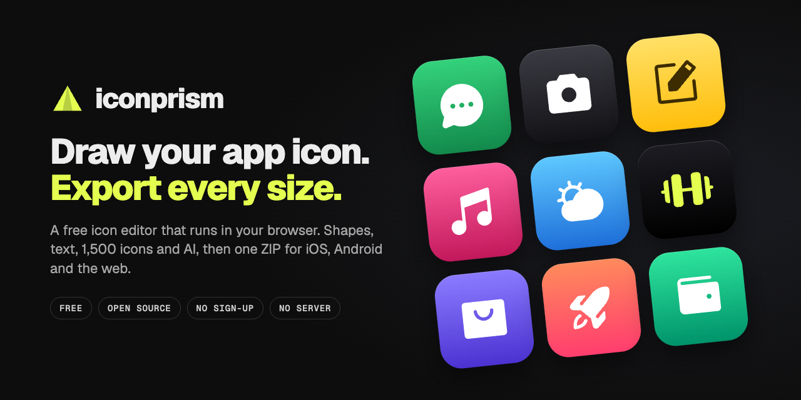
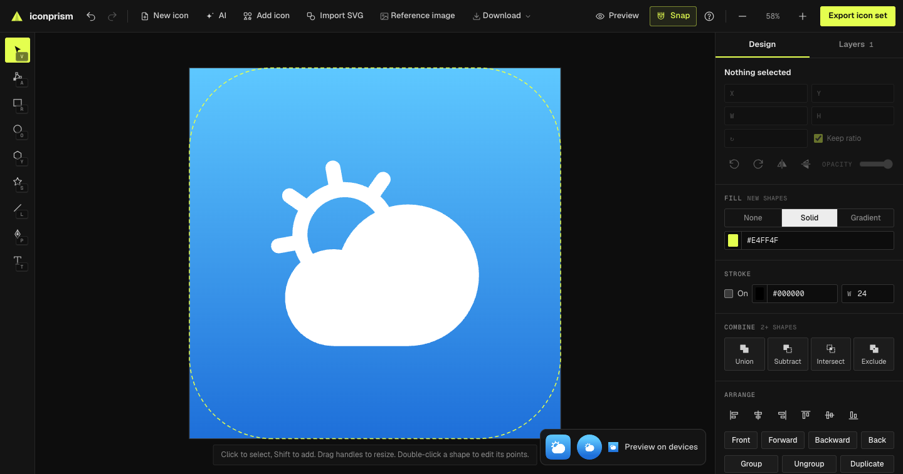
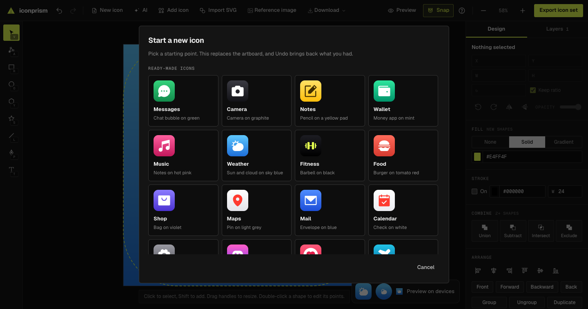
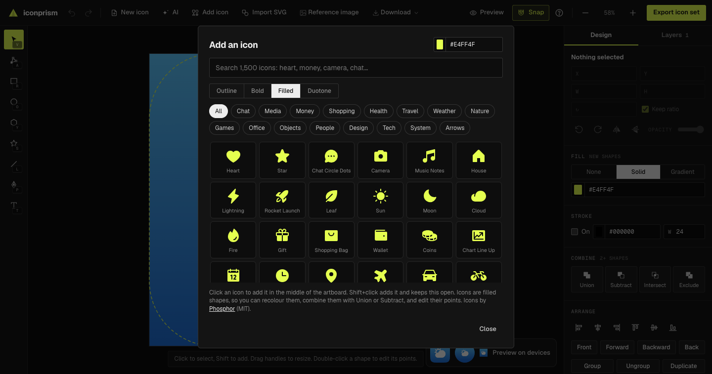
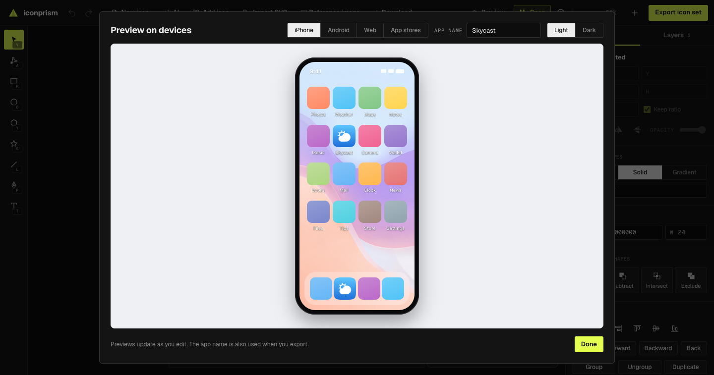
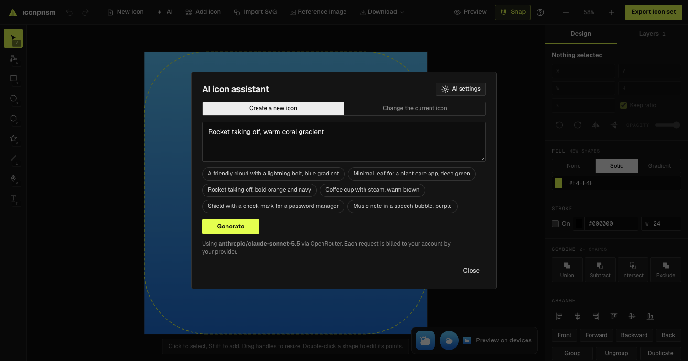

<p align="center">
  <a href="https://boysugi20.github.io/iconprism/"></a>
</p>

<p align="center">
  <a href="https://boysugi20.github.io/iconprism/"></a>
  <a href="LICENSE"></a>
  
  
</p>

<p align="center">
  <b>iconprism</b> is a free, open-source app icon editor that runs in your browser.<br>
  Draw with simple vector tools, start from a template or one of 1,500 icons, or ask AI,<br>
  then download every size for <b>iOS</b>, <b>Android</b> and the <b>web</b> in one ZIP.
</p>

<p align="center">
  <a href="https://boysugi20.github.io/iconprism/"><b>Open iconprism →</b></a>
  &nbsp;·&nbsp; <a href="#features">Features</a>
  &nbsp;·&nbsp; <a href="#whats-in-the-zip">What's in the ZIP</a>
  &nbsp;·&nbsp; <a href="#run-it-yourself">Run it yourself</a>
</p>

<br>

<p align="center"></p>

## Why iconprism?

Making an app icon shouldn't mean learning a design suite, finding the right plugin, then juggling forty export sizes. iconprism does the whole job in one page:

- **Beginner friendly.** Start from a ready-made icon, recolour it, and export. Shapes snap into place, dashed guides show what phones will crop, and a built-in help sheet is one key away (<kbd>?</kbd>).
- **Real vector tools when you want them.** Edit points and curves, combine shapes, manage layers and type exact sizes.
- **Every format, done right.** One click gives you an Xcode asset catalog, Android adaptive icons, favicons and a web manifest, sized and named the way each platform expects.
- **Private by design.** There's no account and no server. Your work stays in your browser.

## Features

<table>
  <tr>
    <td width="50%" valign="top">
      
      <h3>Start from a template</h3>
      22 finished icons (messages, camera, wallet, weather and more) plus simple starting shapes. Pick one, change the colours, make it yours.
    </td>
    <td width="50%" valign="top">
      
      <h3>1,500 icons, ready to edit</h3>
      Search the <a href="https://phosphoricons.com">Phosphor</a> library by name or meaning ("money" finds wallets and coins) in four styles. Every icon arrives as an editable shape in your colour.
    </td>
  </tr>
  <tr>
    <td width="50%" valign="top">
      
      <h3>See it on a real home screen</h3>
      Preview your icon on iPhone and Android home screens, in a browser tab, in app store listings and in a notification, in light and dark.
    </td>
    <td width="50%" valign="top">
      
      <h3>AI, with your own key</h3>
      Describe an icon, or ask for a change ("make it a green gradient"). You see a preview first, and the result comes in as editable shapes. Works with OpenRouter, OpenAI, Gemini, or local models.
    </td>
  </tr>
</table>

### Everything else

| | |
| --- | --- |
| **Draw** | Rectangle (with corner radius), ellipse, polygon, star, line and pen on a 1024 × 1024 artboard |
| **Text** | Type on the canvas in 13 bundled fonts or your own `.ttf`/`.otf`/`.woff`. Text is saved as vector outlines, so it exports exactly and still re-opens as text. |
| **Edit** | Move, resize, rotate, flip, align, reorder and group. Drag individual points and curve handles. |
| **Combine** | Union, subtract, intersect and exclude, on shapes, icons and text alike |
| **Style** | Solid or gradient fills, strokes, opacity, and a solid or gradient background |
| **Layers** | Select, rename, reorder by dragging, hide and lock |
| **Snapping** | To the artboard's edges and centre and to other shapes. Hold <kbd>⌘</kbd>/<kbd>Ctrl</kbd> to skip it. |
| **Reference image** | Put a sketch or logo under your shapes to trace. Fade it, move it, resize it. It's never exported. |
| **Import** | SVG files, by button or drag and drop |
| **Export** | The full icon set, a single SVG or PNG, or the SVG code copied to the clipboard |
| **Works anywhere** | The layout adapts from wide monitors down to phones, and your work is saved automatically |

## What's in the ZIP

| Platform | You get |
| --- | --- |
| **iOS** | `AppIcon.appiconset` with a 1024 px icon (saved without an alpha channel, as App Store Connect requires) and `Contents.json`. Xcode 14+ builds the other sizes. Optional iOS 18 dark and tinted icons. |
| **Android** | `mipmap-mdpi` to `mipmap-xxxhdpi`: legacy, round, and adaptive foreground, background and monochrome layers, plus `mipmap-anydpi-v26` XML and a 512 px Play Store icon |
| **Web** | `favicon.ico` (16/32/48), `favicon.svg`, `apple-touch-icon.png`, 192 and 512 px PNGs, a maskable icon, `manifest.webmanifest` and a `<head>` snippet |
| **Extras** | The source `icon.svg`, a 1024 px PNG and any extra sizes you ask for |

The ZIP includes a `README.txt` with install steps for Xcode, Android Studio and Flutter.

<details>
<summary><b>How the artboard maps to each platform</b></summary>

- **iOS** uses the whole artboard and rounds the corners itself. The yellow dashed guide shows roughly where.
- **Android adaptive icons** use a 108 dp canvas where only the centre 72 dp is visible. The artboard fills that centre, and the background extends to the edges. Keep important artwork inside the Android safe-zone guide, because some launchers crop to a circle.
- **iOS and store icons** can't be transparent. If the background is off, they get a solid colour behind the artwork.

</details>

## AI and your privacy

iconprism has no server. The AI assistant calls the provider you choose straight from your browser with your own key, so your prompts and key go only to that provider, which bills your account.

- **Providers:** [OpenRouter](https://openrouter.ai) (one key for hundreds of models), OpenAI, Google Gemini, Ollama or LM Studio on your own computer, or any OpenAI-compatible endpoint
- **Your key** is kept only for the current tab unless you tick *Remember the key on this device*
- **Every AI result is cleaned** before use: scripts, embedded documents, images, event handlers and external links are removed
- **Local models:** start Ollama with `OLLAMA_ORIGINS` set to the site's address, or enable CORS in LM Studio, so the browser is allowed to call it

<details>
<summary><b>Keyboard shortcuts</b></summary>

| Key | Action |
| --- | --- |
| <kbd>V</kbd> <kbd>A</kbd> | Select, edit points |
| <kbd>R</kbd> <kbd>O</kbd> <kbd>Y</kbd> <kbd>S</kbd> | Rectangle, ellipse, polygon, star |
| <kbd>L</kbd> <kbd>P</kbd> <kbd>T</kbd> | Line, pen, text |
| <kbd>Enter</kbd> | Edit the selected text, or finish typing (<kbd>Shift</kbd>+<kbd>Enter</kbd> for a new line) |
| <kbd>Shift</kbd> | Squares, circles and 45° lines while drawing; keep proportions while resizing; add to the selection |
| <kbd>Alt</kbd> | Draw from the centre; move one curve handle on its own |
| <kbd>⌘</kbd><kbd>Z</kbd> / <kbd>⇧</kbd><kbd>⌘</kbd><kbd>Z</kbd> | Undo, redo |
| <kbd>⌘</kbd><kbd>D</kbd> <kbd>⌘</kbd><kbd>G</kbd> <kbd>⇧</kbd><kbd>⌘</kbd><kbd>G</kbd> | Duplicate, group, ungroup |
| <kbd>⌘</kbd><kbd>C</kbd> <kbd>⌘</kbd><kbd>X</kbd> <kbd>⌘</kbd><kbd>V</kbd> | Copy, cut, paste |
| Arrow keys | Nudge 1 px (<kbd>Shift</kbd>: 10 px) |
| <kbd>Space</kbd> + drag, scroll | Pan |
| <kbd>⌘</kbd> + scroll, pinch | Zoom |
| <kbd>⇧</kbd><kbd>1</kbd>, <kbd>⌘</kbd><kbd>0</kbd> | Fit the artboard |
| <kbd>?</kbd> | Help and all shortcuts |

Use <kbd>Ctrl</kbd> in place of <kbd>⌘</kbd> on Windows and Linux.

</details>

## Run it yourself

You need [Node.js](https://nodejs.org) 20.19 or newer.

```bash
git clone https://github.com/boysugi20/iconprism.git
cd iconprism
npm install
npm run dev
```

| Command | What it does |
| --- | --- |
| `npm run dev` | Starts the editor at `http://localhost:5173` with live reload |
| `npm test` | Runs the unit tests (Vitest) |
| `npm run build` | Type-checks and builds a static site into `dist/` |
| `npm run preview` | Serves the built site locally |

Pushing to `main` builds, tests and deploys to GitHub Pages through [`.github/workflows/pages.yml`](.github/workflows/pages.yml). The build is plain static files, so any static host works too.

### Project layout

```text
src/
  editor.ts     Vector editor: tools, selection, history, snapping, layers, booleans
  render.ts     Turns the artwork into PNG and ICO files, masks and adaptive layers
  export.ts     Builds the ZIP for iOS, Android and the web
  text.ts       Fonts and text-to-outline layout
  iconlib.ts    Icon library loading and search
  templates.ts  Ready-made icons and starting points
  ai.ts         Bring-your-own-key AI client and SVG cleaning
  devices.ts    Home screen, browser and store mock-ups
  main.ts       Wires the interface together
test/           Unit tests
```

## Contributing

Bug reports, ideas and pull requests are welcome.

1. Open an issue that describes the problem or idea, ideally with a screenshot.
2. Fork the repo and create a branch.
3. Keep changes focused, and add a test for logic that can be tested without a browser.
4. Run `npm test` and `npm run build` before you open a pull request.

## Credits

- [Paper.js](http://paperjs.org): vector editing and boolean operations
- [opentype.js](https://opentype.js.org): turning text into outlines
- [JSZip](https://stuk.github.io/jszip/): building the ZIP
- [Phosphor Icons](https://github.com/phosphor-icons/core): the icon library, MIT licensed (© 2023 Phosphor Icons)
- [Fontsource](https://fontsource.org): the bundled fonts, under the SIL Open Font License
- The phone wallpapers in the device preview were generated for this project with FLUX 3 Image Klein (Black Forest Labs) through OpenRouter.

## License

[MIT](LICENSE). Use it, change it and share it.
